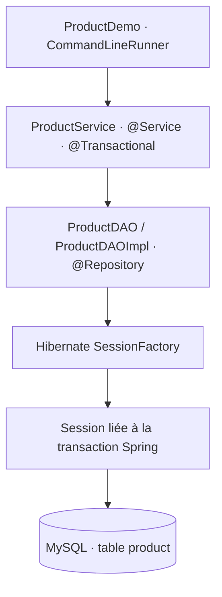

# Évaluation pratique — Spring IoC et Hibernate

Solution de l’évaluation de **1 h 30**, notée sur **20 points** : deux applications Java indépendantes, exécutées en console avec `CommandLineRunner`.

- **Exercice 1 — 8 points :** notifications Email/SMS, composants Spring, injection par constructeur et sélection du service Email avec `@Qualifier`.
- **Exercice 2 — 12 points :** gestion de produits avec Spring IoC, Hibernate natif, transactions au niveau du service et persistance MySQL.

Les opérations de persistance utilisent directement `SessionFactory`, `Session`, `persist()`, `get()`, `createQuery()` et `remove()`. Le projet ne dépend pas de Spring Data JPA et ne contient aucun `JpaRepository` ou `CrudRepository`.

## Technologies

| Composant | Version |
| --- | --- |
| Java | 17 minimum |
| Spring Boot | 4.0.9 |
| Spring Framework | 7.0.10, gérée par Spring Boot |
| Hibernate ORM | 7.2.25.Final, gérée par Spring Boot |
| MySQL | 8.4, via Docker Compose ou un serveur existant |
| Maven Wrapper | Maven 3.9.11 |
| Tests | JUnit Jupiter, AssertJ, H2 et vérification sur MySQL |

Le wrapper fourni permet de compiler sans installer Maven séparément. Un JDK et une connexion Internet sont nécessaires pour la première compilation. Docker n’est nécessaire que si vous utilisez le serveur MySQL fourni.

## Démarrage sous Windows / PowerShell

### 1. Cloner et compiler

```powershell
git clone https://github.com/imranelak1/microservice-evaluation1h30.git
cd microservice-evaluation1h30
.\mvnw.cmd clean verify
```

Cette commande lance les cinq tests et construit les deux JAR exécutables. Les tests standard utilisent H2 en mémoire ; ils ne nécessitent pas MySQL.

### 2. Exécuter les notifications

```powershell
java "-Dfile.encoding=UTF-8" -jar notification-app/target/notification-app-1.0.0.jar --debug=false
```

```text
=== Gestion des notifications ===
[EMAIL] Votre commande a été confirmée.
```

Les deux services simulent l’envoi par un affichage en console. Aucun email ni SMS réel n’est envoyé ; aucune clé d’API ou configuration SMTP n’est requise.

### 3. Démarrer MySQL et exécuter la gestion des produits

Ouvrir Docker Desktop avec le moteur Linux, puis exécuter :

```powershell
docker compose up -d --wait
java "-Dfile.encoding=UTF-8" -jar product-app/target/product-app-1.0.0.jar --debug=false
```

Compose crée la base `evaluation_produits`. Hibernate crée la table `product` à partir de l’entité lors du premier démarrage, grâce à `hibernate.hbm2ddl.auto=update`.

Sur une base vide, le scénario produit ce résultat :

```text
=== Gestion des produits ===

Produit ajouté : Ordinateur
Produit ajouté : Souris
Produit ajouté : Clavier

Liste des produits :
1 - Ordinateur - 7500 DH
2 - Souris - 150 DH
3 - Clavier - 250 DH

Recherche : Souris

Suppression du produit 2

Liste finale :
1 - Ordinateur
3 - Clavier
```

Les identifiants sont générés par MySQL. Le programme utilise l’identifiant réellement attribué à « Souris » pour la recherche et la suppression. Les données sont conservées dans un volume Docker : chaque nouvelle exécution ajoute trois produits, puis supprime la souris ajoutée lors de cette exécution, en conservant les enregistrements précédents.

Pour arrêter MySQL en conservant les données :

```powershell
docker compose stop
```

Sous Linux/macOS, utiliser `./mvnw clean verify` à la place de `.\mvnw.cmd clean verify`. Les commandes `java` et `docker compose` sont identiques.

## Organisation du projet

```text
microservice-evaluation1h30/
├── pom.xml                          # Projet Maven parent, Java 17
├── mvnw / mvnw.cmd                  # Maven Wrapper
├── compose.yaml                     # MySQL 8.4 et volume de données
├── notification-app/
│   └── src/
│       ├── main/java/ma/emsi/evaluation/notifications/
│       │   ├── NotificationService.java
│       │   ├── EmailNotificationService.java
│       │   ├── SmsNotificationService.java
│       │   ├── NotificationManager.java
│       │   └── NotificationApplication.java
│       └── test/java/.../NotificationInjectionTest.java
├── product-app/
│   └── src/
│       ├── main/java/ma/emsi/evaluation/products/
│       │   ├── entity/Product.java
│       │   ├── config/HibernateConfig.java
│       │   ├── dao/ProductDAO.java
│       │   ├── dao/ProductDAOImpl.java
│       │   ├── service/ProductService.java
│       │   ├── ProductDemo.java
│       │   └── ProductApplication.java
│       └── test/java/.../ProductServiceIntegrationTest.java
└── docs/                            # Sorties réelles et bilan des vérifications
```

## Exercice 1 — Injection des notifications

`NotificationService` expose `void envoyer(String message)`. `EmailNotificationService` et `SmsNotificationService` implémentent cette interface et portent l’annotation `@Service`.

`NotificationManager`, annoté `@Component`, reçoit le service dans son constructeur :

```java
public NotificationManager(
        @Qualifier("emailNotificationService") NotificationService notificationService) {
    this.notificationService = notificationService;
}
```

Le qualificateur résout l’ambiguïté entre les deux implémentations. `NotificationApplication` implémente `CommandLineRunner` et appelle le manager injecté. Les tests démarrent un vrai contexte Spring avec les deux services et vérifient que le manager choisit Email ; un second test vérifie le service SMS.

## Exercice 2 — Produits et Hibernate natif



### Modèle de données

| Attribut | Type Java | Mapping |
| --- | --- | --- |
| `id` | `Long` | `@Id`, `@GeneratedValue(strategy = IDENTITY)` |
| `nom` | `String` | Colonne non nulle |
| `prix` | `Double` | Colonne non nulle |
| `quantite` | `Integer` | Colonne non nulle |

L’entité porte `@Entity` et `@Table(name = "product")`. Les types correspondent à ceux du sujet.

### Configuration et transactions

`HibernateConfig` déclare un `LocalSessionFactoryBean`, lui fournit le `DataSource` MySQL et l’entité `Product`, puis déclare un `HibernateTransactionManager` pour cette même fabrique. `@EnableTransactionManagement` active les transactions déclaratives.

Avec Spring Framework 7, les classes d’intégration Hibernate native se trouvent dans `org.springframework.orm.jpa.hibernate`. Ce nom de package fait partie de Spring ORM ; les accès aux produits restent réalisés avec l’API native Hibernate.

`ProductService` reçoit `ProductDAO` par constructeur et porte `@Transactional`. Les méthodes de consultation utilisent `@Transactional(readOnly = true)`. Le DAO reçoit `SessionFactory` par constructeur et utilise `getCurrentSession()` : Spring ouvre la session, valide ou annule la transaction, puis libère les ressources. Le DAO ne crée aucune transaction indépendante.

### Interface DAO et opérations

```java
public interface ProductDAO {
    void save(Product product);
    Product findById(Long id);
    List<Product> findAll();
    void delete(Long id);
}
```

| Méthode | API Hibernate utilisée |
| --- | --- |
| `save` | `Session.persist(product)` |
| `findById` | `Session.get(Product.class, id)` |
| `findAll` | `Session.createQuery("from Product order by id", Product.class)` |
| `delete` | `Session.get(...)`, puis `Session.remove(...)` si le produit existe |

Un identifiant absent retourne `null` lors de la recherche ; sa suppression ne modifie aucun autre produit. Le runner ajoute trois produits, affiche la liste, recherche la souris, la supprime et affiche la liste finale.

## Configuration MySQL

Les valeurs de développement par défaut correspondent à `compose.yaml` :

| Variable | Valeur par défaut | Usage |
| --- | --- | --- |
| `DB_PORT` | `3307` | Port MySQL exposé sur localhost |
| `DB_NAME` | `evaluation_produits` | Base de données |
| `DB_USERNAME` | `evaluation` | Utilisateur applicatif |
| `DB_PASSWORD` | `evaluation_dev` | Mot de passe du serveur de démonstration |
| `DB_URL` | URL JDBC locale construite avec `DB_PORT` et `DB_NAME` | Remplace l’URL complète si défini |
| `MYSQL_ROOT_PASSWORD` | `root_dev_only` | Administration du serveur Docker |
| `HIBERNATE_DDL_AUTO` | `update` | Création/évolution de la table par Hibernate |
| `HIBERNATE_SHOW_SQL` | `false` | Affichage des requêtes SQL |
| `DEMO_ENABLED` | `true` | Activation du scénario de démonstration |

Pour utiliser un serveur MySQL existant, créer une base dédiée et définir les variables dans le terminal avant de lancer le JAR :

```powershell
$env:DB_URL = 'jdbc:mysql://localhost:3306/evaluation_produits?useSSL=false&allowPublicKeyRetrieval=true&serverTimezone=UTC'
$env:DB_USERNAME = 'votre_utilisateur'
$env:DB_PASSWORD = 'votre_mot_de_passe'
java "-Dfile.encoding=UTF-8" -jar product-app/target/product-app-1.0.0.jar --debug=false
```

La base doit exister et l’utilisateur doit pouvoir créer la table et manipuler ses données. Les paramètres `useSSL=false` et `allowPublicKeyRetrieval=true` servent à la démonstration locale fournie.

## Tests et vérifications

```powershell
.\mvnw.cmd clean verify
```

Les cinq tests couvrent la sélection du service Email, le service SMS, les opérations DAO via le service, la recherche/suppression d’un identifiant absent et le rollback d’une insertion lors d’une exception. Les tests de produits n’ont pas de transaction englobante de test : ils exercent les vraies frontières transactionnelles du service.

Le profil `test` utilise H2 en mémoire par défaut. Les trois tests de produits ont aussi été exécutés sur MySQL 8.4 avec succès. Pour reproduire cette vérification, utiliser une **base de test dédiée** : ce profil crée puis supprime sa table `product`.

Depuis le serveur MySQL fourni, créer une base de test et accorder les droits à l’utilisateur de démonstration :

```powershell
docker compose exec mysql mysql -uroot -p
```

Entrer le mot de passe root défini pour Compose, puis exécuter :

```sql
CREATE DATABASE IF NOT EXISTS evaluation_produits_test;
GRANT ALL PRIVILEGES ON evaluation_produits_test.* TO 'evaluation'@'%';
exit
```

Dans PowerShell :

```powershell
$env:TEST_DB_URL = 'jdbc:mysql://localhost:3307/evaluation_produits_test?useSSL=false&allowPublicKeyRetrieval=true&serverTimezone=UTC'
$env:TEST_DB_DRIVER = 'com.mysql.cj.jdbc.Driver'
$env:TEST_DB_USERNAME = 'evaluation'
$env:TEST_DB_PASSWORD = 'evaluation_dev'
.\mvnw.cmd -pl product-app test
Remove-Item Env:TEST_DB_URL, Env:TEST_DB_DRIVER, Env:TEST_DB_USERNAME, Env:TEST_DB_PASSWORD
```

Les [sorties d’exécution](docs/) et le [bilan de vérification](docs/verification.md) documentent les résultats observés. Aucune note officielle n’est présumée.

## Correspondance avec le barème

| Partie | Points | Réalisation |
| --- | --- | --- |
| Exercice 1 — Spring IoC | 8 | Interface, services Email/SMS, composants, constructeur, qualificateur, runner |
| Configuration Hibernate | 3 | Connexion MySQL, `SessionFactory`, table créée depuis `Product` |
| DAO avec SessionFactory | 4 | Interface demandée et CRUD avec l’API `Session` |
| Service avec injection IoC | 3 | `@Service`, injection par constructeur et `@Transactional` |
| Exécution | 2 | Trois insertions, consultation, recherche, suppression, liste finale |
| **Total du sujet** | **20** | Couverture des exigences ; évaluation laissée à l’enseignant |

## Références techniques

- [Intégration Hibernate native dans Spring Framework](https://docs.spring.io/spring-framework/reference/data-access/orm/hibernate.html)
- [Gestionnaire de transactions Hibernate](https://docs.spring.io/spring-framework/docs/current/javadoc-api/org/springframework/orm/jpa/hibernate/HibernateTransactionManager.html)
- [Versions gérées par Spring Boot 4.0](https://docs.spring.io/spring-boot/4.0/appendix/dependency-versions/coordinates.html)
